

**I build full-stack products, design clean interfaces, and ship AI-powered systems, from wireframe to deployment.**

 

 
 

<a href="#about">About</a> &nbsp;·&nbsp;
<a href="#tech-stack">Tech Stack</a> &nbsp;·&nbsp;
<a href="#featured-projects">Projects</a> &nbsp;·&nbsp;
<a href="#certifications">Certifications</a> &nbsp;·&nbsp;
<a href="#education">Education</a> &nbsp;·&nbsp;
<a href="#lets-connect">Contact</a>

 

## About

I'm a Software Engineering graduate who enjoys turning ideas into polished, working products. My approach is **design-led engineering**: clean architecture, transparent systems, and interfaces that are as thoughtful as the code behind them.

<table>
  <tr>
    <td width="50%" valign="top">
      <b>EDUCATION</b> 
      <b>BS Software Engineering</b> 
      NUML University, Islamabad · CGPA 3.65
    </td>
    <td width="50%" valign="top">
      <b>FOCUS</b> 
      <b>Full-Stack · AI/ML</b> 
      UI/UX · Data visualization
    </td>
  </tr>
  <tr>
    <td width="50%" valign="top">
      <b>CERTIFIED BY</b> 
      <b>Google · Meta · IBM</b> 
      DeepLearning.AI · NAVTTC
    </td>
    <td width="50%" valign="top">
      <b>BASED IN</b> 
      <b>Islamabad, Pakistan</b> 
      Open to job opportunities, freelance work and collaborations
    </td>
  </tr>
</table>

 

## Tech Stack

<table>
  <tr>
    <td width="50%" valign="top">
      <b>Frontend</b> 
      Responsive, accessible interfaces and mobile apps  

    </td>
    <td width="50%" valign="top">
      <b>Backend & Data</b> 
      APIs, services and databases  

    </td>
  </tr>
  <tr>
    <td width="50%" valign="top">
      <b>AI & Machine Learning</b> 
      Practical ML applied to real problems  

    </td>
    <td width="50%" valign="top">
      <b>Tools & Workflow</b> 
      Version control, tooling and deployment  

    </td>
  </tr>
</table>

 

## Featured Projects

> Some projects are public on GitHub (see the Source code badges). The rest are in private repositories. Feel free to reach out for a walkthrough or demo.

 

### 

*Production-grade web app that turns AI-generated text into natural, human-sounding writing in real time.*

  

  

**Highlights**

- Real-time text transformation with streaming responses
- NLP pipeline that restructures sentences while preserving context
- Standard and Aggressive modes, with an AI score vs human score comparison
- User authentication and a usage analytics dashboard
- Export to PDF, DOCX and TXT, with custom tone and style presets
- Rate limiting and abuse prevention

**Tech stack**&nbsp;       

 

### 

*AI-powered system for detecting deepfake images and videos, with a clean upload-and-scan web interface.*

  

  

  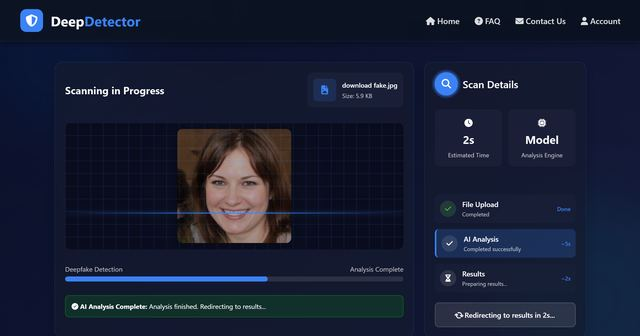

**Highlights**

- CNN-based architecture analysing facial inconsistencies, frequency-domain artifacts and temporal anomalies
- Image analysis (JPG, PNG, up to 5 MB) and video analysis (MP4, MOV, AVI, up to 15 MB), plus live webcam feeds
- Frame-by-frame analysis with confidence heatmaps
- Drag-and-drop upload with one-click scanning and a recent uploads history
- Forensic report generation and batch processing
- Flask API with an HTML, CSS and JavaScript dashboard using WebSocket updates

**Tech stack**&nbsp;        

 

### 

*Role-based collaboration platform connecting Investors and Entrepreneurs: meetings, video calls, document signing and funding in one workflow.*

   

  

**Highlights**

- Role-specific dashboards for Investors and Entrepreneurs
- Meeting requests with accept/decline flow and in-browser video calls
- Document upload with a canvas signature pad and a Draft → In Review → Signed status flow
- Wallet, funding transfers and transaction history
- Runs entirely in the browser with no build step; data is stored in `localStorage` and can be swapped for real API endpoints

<b>View module breakdown</b>

 

| Module | What it does |
|:--|:--|
| **Authentication** | Registration with role selection, password strength meter, mock two-factor authentication, role-specific dashboards |
| **Meeting System** | Investors send requests, entrepreneurs accept or decline, accepted meetings move to "Upcoming Meetings" |
| **Video Call** | Camera and mic via `getUserMedia()`, mute, camera toggle, screen share, call timer, end-call controls |
| **Document Chamber** | File uploads, signature pad, status flow (Draft → In Review → Signed) |
| **Wallet & Payments** | Balances, deposits, withdrawals, transfers, investor-to-entrepreneur funding, transaction history |

**Tech stack**&nbsp;       

 

### 

*Responsive website for a medical credentialing company, presenting provider credentialing, insurance enrollment and compliance services.*

  

  

**Highlights**

- Multi-page site: Home, About, Contact, Blog and FAQ
- Clear calls to action and service sections designed for healthcare providers
- Responsive, user-centric layouts with a clean healthcare-themed UI

**Tech stack**&nbsp;   

 

### Paradise Nursery

*Online plant shop built with React and Redux Toolkit, with a landing page, a plant catalogue by category and a live shopping cart.*

  

  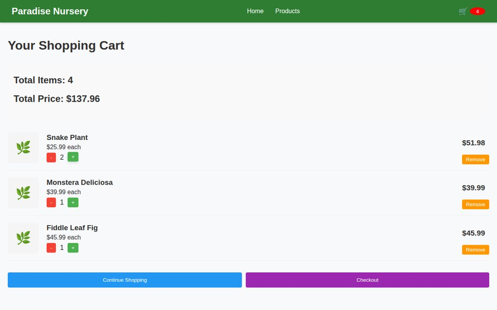
  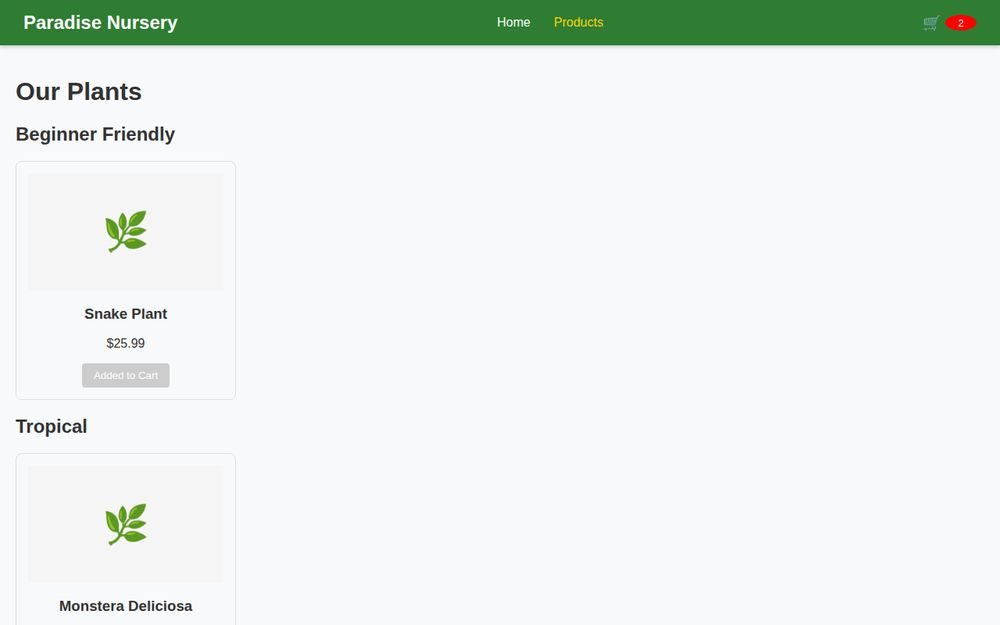

**Highlights**

- Landing page with a call to action that leads into the plant catalogue
- Catalogue grouped by category: Beginner Friendly, Tropical, Statement Plants, Trailing Plants, Low Light and Succulents
- Add to Cart, with the button disabled once the plant is already in the cart
- Shopping cart with quantity increase and decrease, remove item, total items and total price
- Cart count badge in the header that updates live
- Client-side routing between Home, Products and Cart

**Tech stack**&nbsp;     

 

### Pet Care App

*Mobile-first app for pet owners, designed in Figma, covering pet care, services, shopping and educational content.*

  

  
  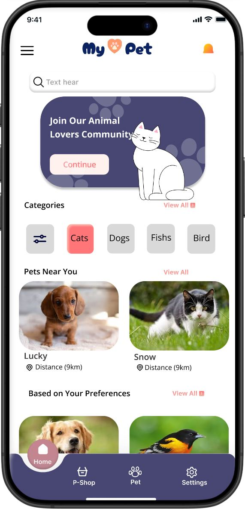
  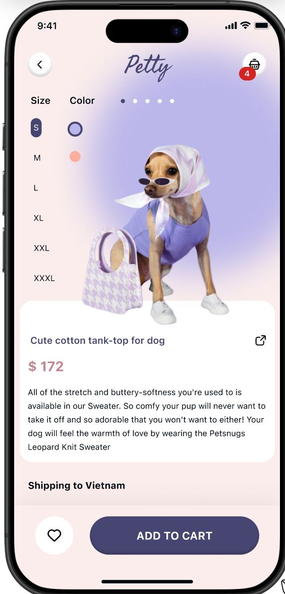

> Sample screens only, not the complete design. More screens will be added soon.

**Highlights**

- Home screen with a promotional banner, pet category shortcuts and notifications
- Educational content and a services section, with bottom navigation across Home, P-Mart, Service and Pet
- Vaccination and medication tracking with reminders
- Vet appointment scheduler and health metrics logging
- Multi-pet profiles and a photo journal
- MyPet home with a community banner, pet categories (Cats, Dogs, Fish, Birds) and Pets Near You
- Petty shop product screen with size and colour options, price, favourite and Add to Cart

**Tech stack**&nbsp;    

 

### Mega Mart

*Mobile shopping app UI designed in Figma, with a clean red theme, category browsing, special offers and a full product listing flow.*

  

  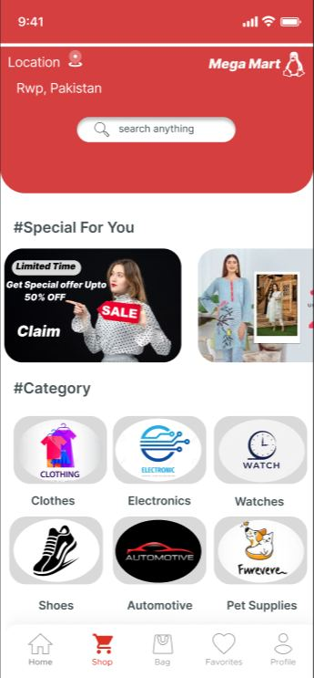
  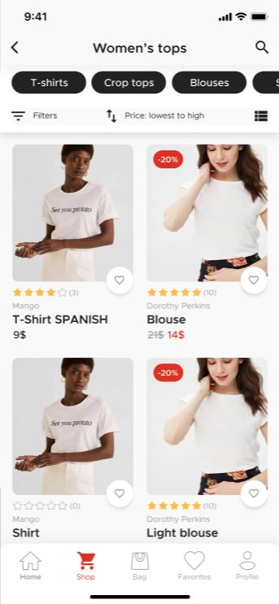
  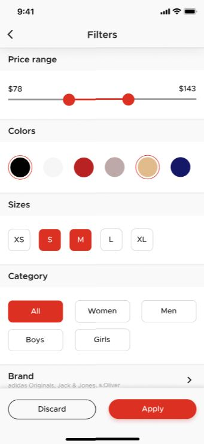
  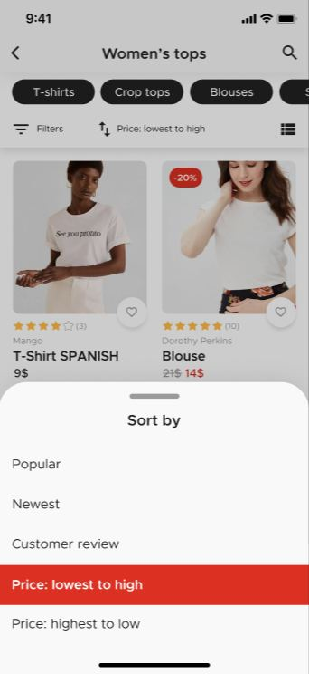
  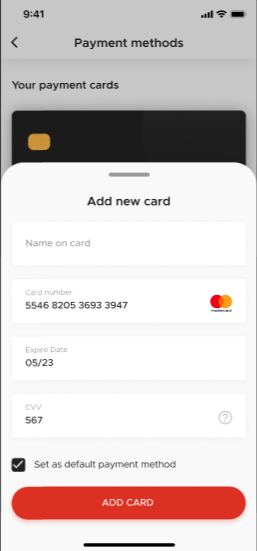

> Sample screens only, not the complete design. More screens will be added soon.

**Highlights**

- Home screen with location, search bar, special offers banner and category shortcuts (Clothes, Electronics, Watches, Shoes, Automotive, Pet Supplies)
- Product listing screen with category chips, filters and price sorting
- Product cards with ratings, discount badges, prices and favourite button
- Bottom navigation across Home, Shop, Bag, Favorites and Profile
- Filters screen with price range slider, colours, sizes, category and brand, plus a Sort by sheet
- Add new card payment screen with card details and a default payment option

**Tech stack**&nbsp;    

 

### Brainy Buddies Game

*Playful learning game for kids, designed in Figma, where children learn alphabets, spelling, colours, animals and maths questions through levels.*

  

  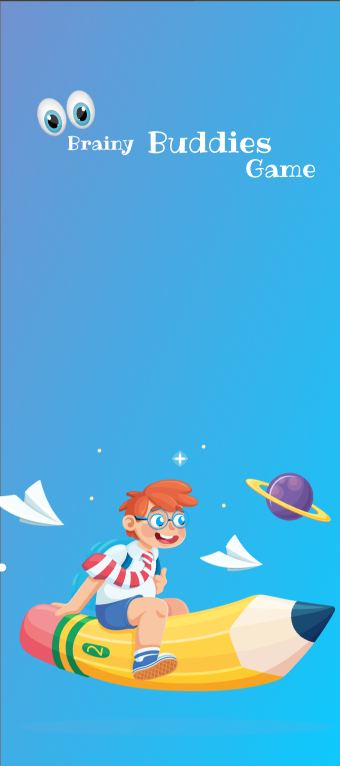
  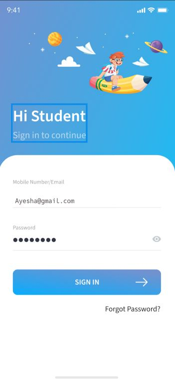
  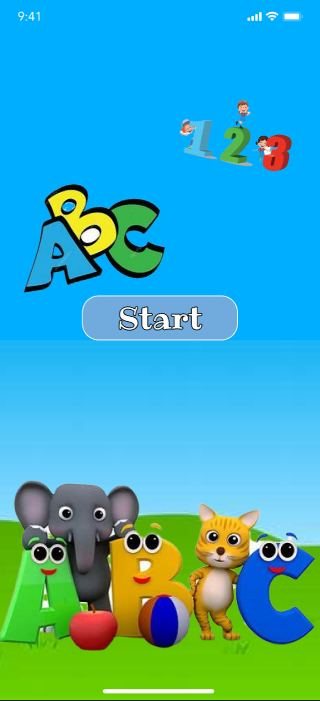
  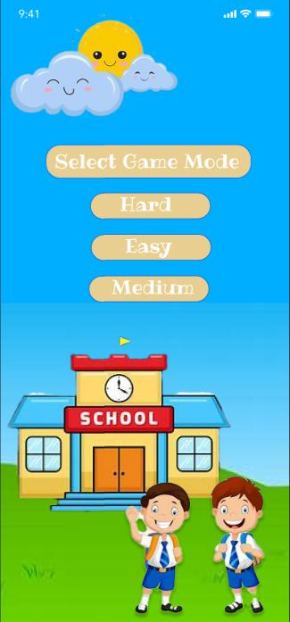

  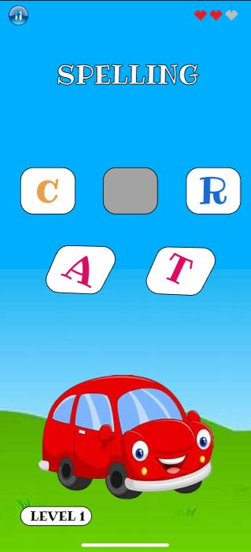
  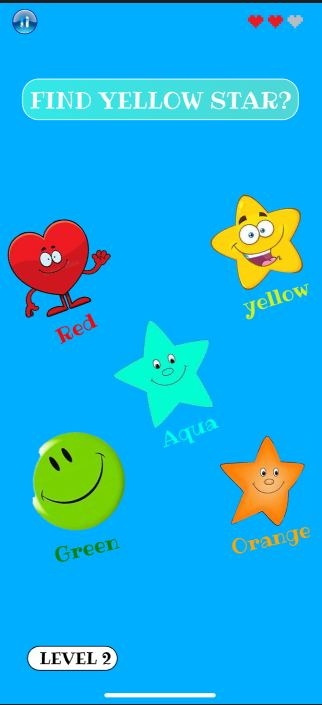
  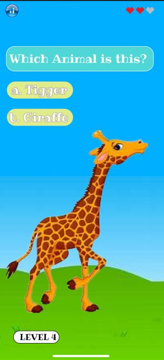

> Sample screens only, not the complete design. More screens will be added soon.

**Highlights**

- Student sign-in screen and a start screen with a friendly ABC theme
- Game modes: Easy, Medium and Hard
- Level-based questions such as spelling, find the yellow star and which animal is this
- Lives shown as hearts, a level badge and a pause button
- Alphabets and maths questions, with colourful cartoon characters designed for children

**Tech stack**&nbsp;    

 

### HavenWorks

*News app concept designed in Figma, with trending stories, latest news by category, live sports matches and saved sources.*

  

  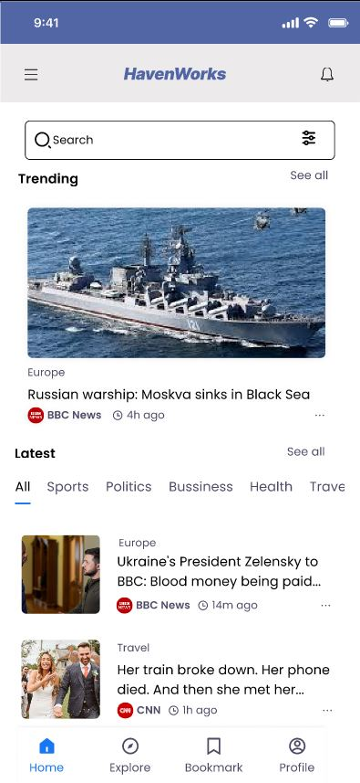
  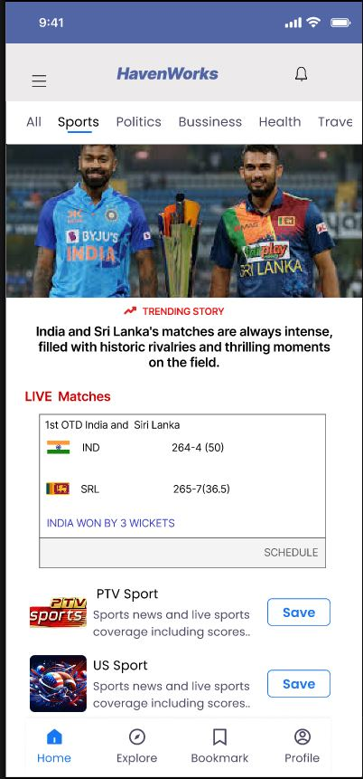
  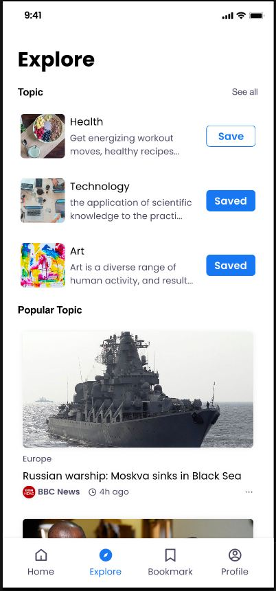
  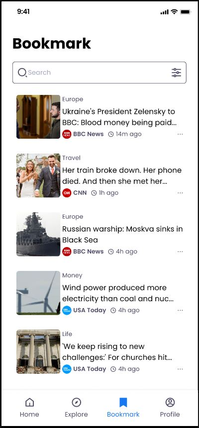
  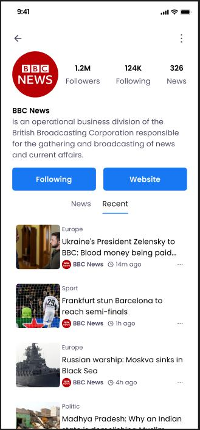

> Sample screens only, not the complete design. More screens will be added soon.

**Highlights**

- Home screen with a trending story and a latest news feed with source and time
- Category tabs: All, Sports, Politics, Business, Health and Travel
- Sports screen with a trending story, live match scorecard and sports sources with a Save button
- Bottom navigation across Home, Explore, Bookmark and Profile
- Explore screen with topics (Health, Technology, Art) that can be saved, plus popular stories
- Bookmark screen for saved articles, and a publisher profile with followers and recent news

**Tech stack**&nbsp;    

 

### NUML Website Redesign

*Recreation of the National University of Modern Languages website in Figma, with a dark hero section, photo grid and a campuses page.*

  

  

  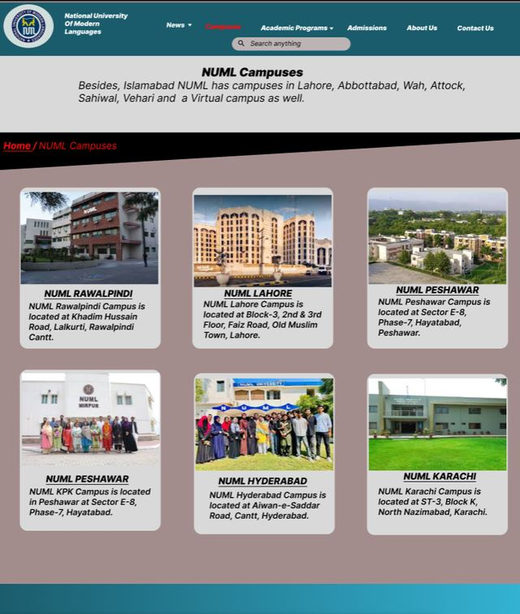

> Sample screens only, not the complete design. More screens will be added soon.

**Highlights**

- Home page with university introduction, photo grid and social links
- Top navigation: News, Campuses, Academic Programs, Admissions, Facilities and Contact Us, with a search bar
- Campuses page with a card for each NUML campus: Rawalpindi, Lahore, Peshawar, Hyderabad, Karachi and more

**Tech stack**&nbsp;   

 

### Yale School of Art Website

*Recreation of the Yale School of Art website in Figma for desktop and mobile, covering the home page, latest news and the admissions page.*

  

  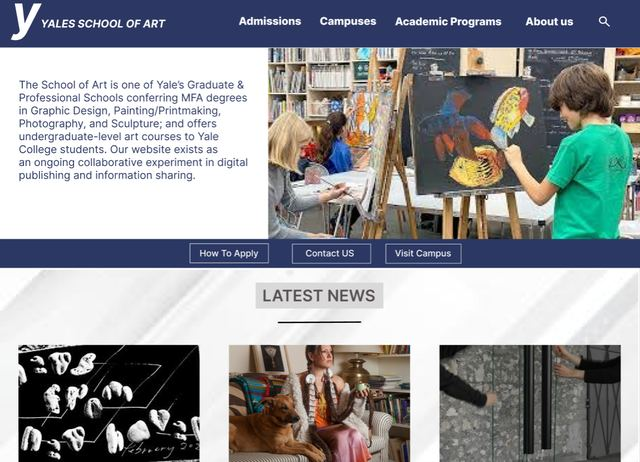
  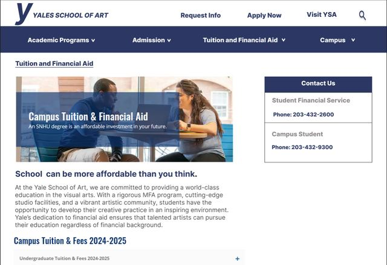

  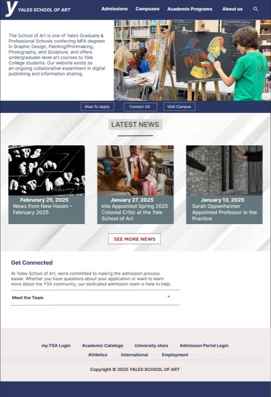
  
  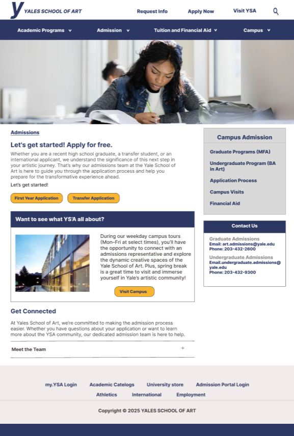

> Sample screens only, not the complete design. More screens will be added soon.

**Highlights**

- Home page with a hero image, call-to-action buttons and a Latest News section
- Admissions page with application buttons, campus visit block and contact details
- Responsive layouts designed for both desktop and mobile
- Footer with quick links and an expandable Meet the Team section
- Tuition and Financial Aid page with a contact card and expandable fee sections

**Tech stack**&nbsp;   

 

### CAVS 55 Event Website

*Recreation in Figma of the CAVS 55 event page by MIT's Program in Art, Culture and Technology, a student project with a green and grey editorial layout.*

  

  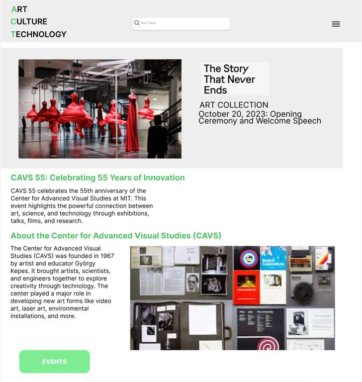
  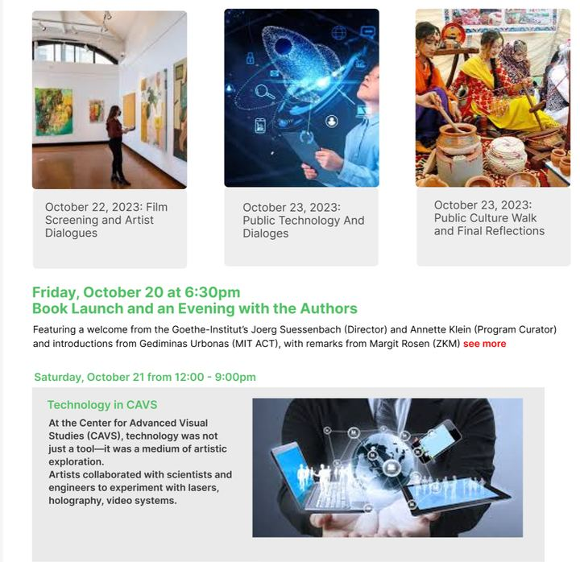

  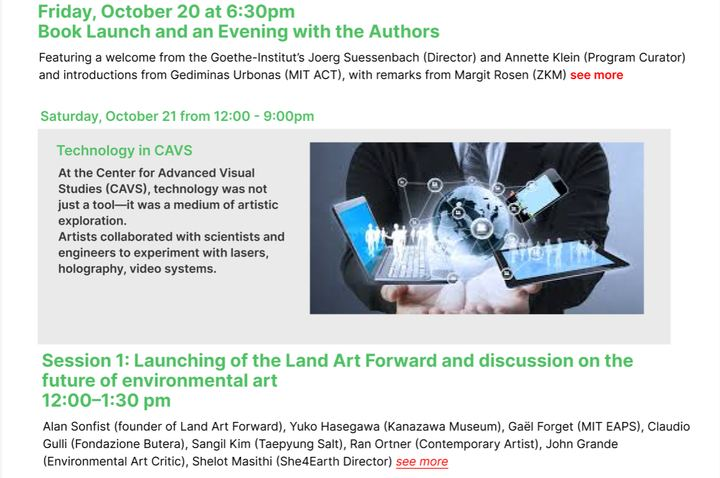
  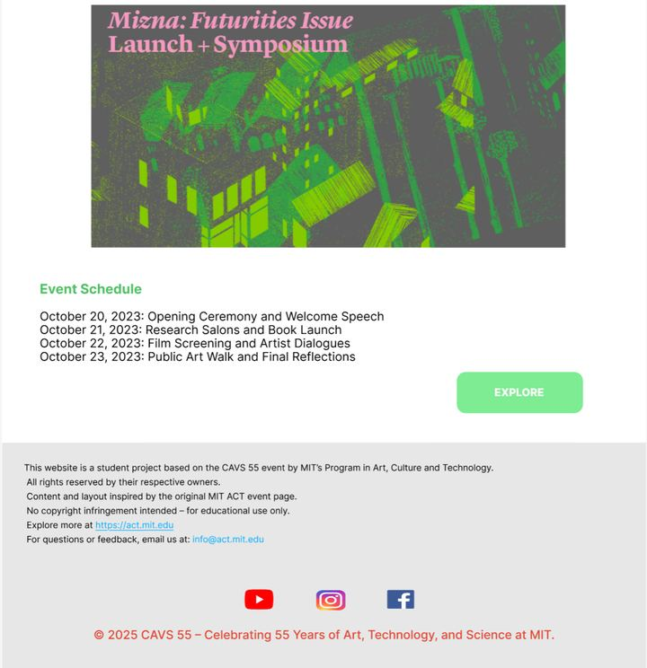

> Sample screens only, not the complete design. More screens will be added soon.

**Highlights**

- Hero banner with the event title, art collection image and opening ceremony details
- Sections about CAVS 55 and the Center for Advanced Visual Studies with image blocks
- Event highlight cards for film screening, public technology dialogues and the culture walk
- Detailed session blocks, such as Technology in CAVS and Session 1, with see more links
- Event schedule, Explore and Events buttons, and a footer with social links and a student project disclaimer

**Tech stack**&nbsp;   

 

### More Projects

| Project | Description | Tech |
|:--|:--|:--|
| **AI Content Studio** | SaaS platform for generating and rewriting blog posts, social content and marketing copy, with brand voice training, SEO suggestions, team workspaces and Stripe billing | `MongoDB` `Express` `Node.js` `HTML5` `CSS3` `JavaScript` `OpenAI` `Stripe` |
| **[Portfolio Website](https://YOUR_PORTFOLIO_URL)** | Responsive personal portfolio with smooth animations, project case studies and a certification showcase | `HTML5` `CSS3` `JavaScript` `Tailwind CSS` `GSAP` |

 

## Certifications

| Certification | Issuer | Year |
|:--|:--|:--:|
| Google UX Design Professional | Google · Coursera | 2025 |
| AI & Deep Learning Specialization | DeepLearning.AI · Coursera | 2024 |
| Meta Front-End Developer | Meta · Coursera | 2024 |
| IBM Full Stack Software Developer | IBM · Coursera | 2024 |
| Google Data Analytics | Google · Coursera | 2023 |
| National Skills Competency (82nd percentile) | NAVTTC · Pakistan | 2023 |

 

## Education

| Qualification | Institution | Years |
|:--|:--|:--:|
| **BS Software Engineering** · CGPA 3.65 | NUML University, Islamabad | 2022 – 2026 |
| Intermediate (Pre-Engineering) | Mulhal Science College | 2019 – 2021 |
| Matriculation (Pre-Medical) | Sir Syed Model Secondary School | 2017 – 2019 |

 

## How I Work

<table>
  <tr>
    <td width="50%" valign="top">
      <b>DESIGN-LED</b> 
      Every interface is designed in Figma first
    </td>
    <td width="50%" valign="top">
      <b>RELIABLE</b> 
      Cross-device compatibility and optimized pipelines
    </td>
  </tr>
  <tr>
    <td width="50%" valign="top">
      <b>APPLIED AI</b> 
      Practical ML applied to real problems
    </td>
    <td width="50%" valign="top">
      <b>SCALABLE</b> 
      Clean architecture, real-time dashboards and interpretable results for non-technical users
    </td>
  </tr>
</table>

 

## Let's Connect

I'm open to job opportunities, freelance work and collaborations.

