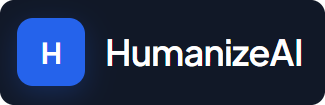
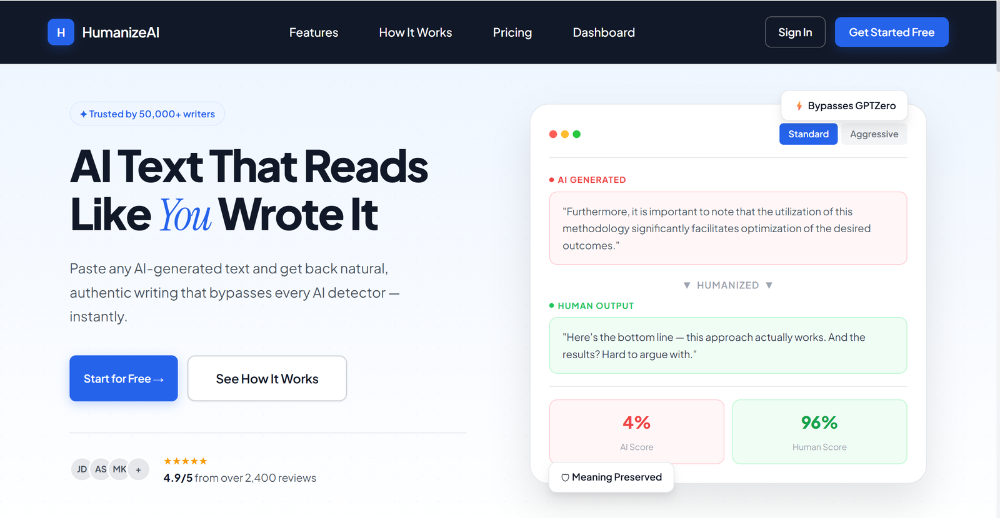
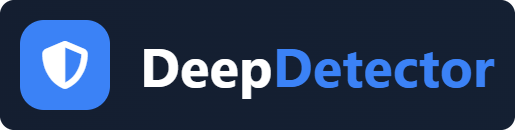
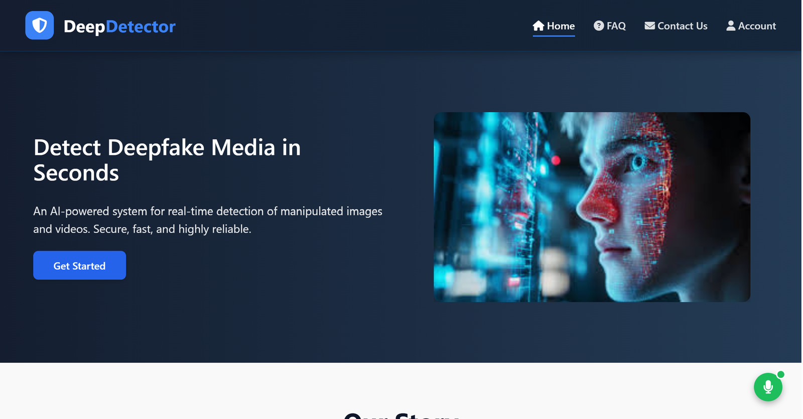
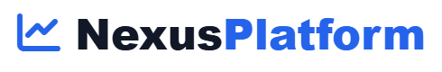
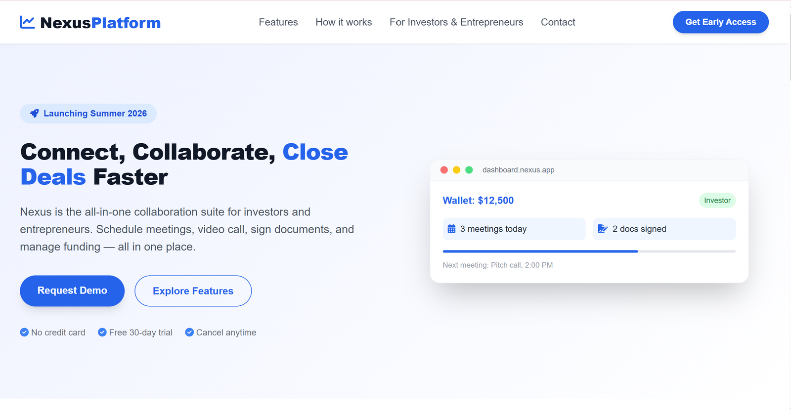
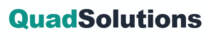
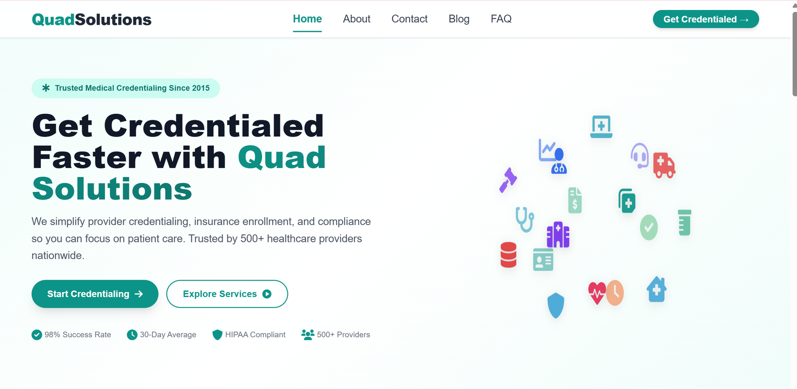
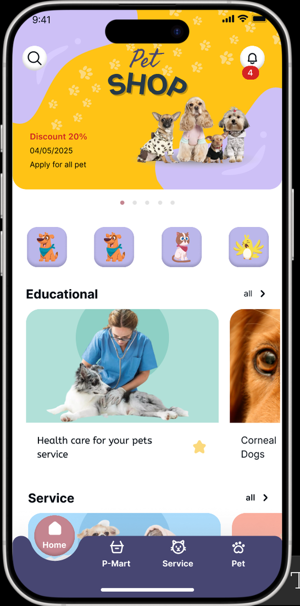

**I build full-stack products, design clean interfaces, and ship AI-powered systems, from wireframe to deployment.**

 

 
 

<a href="#about">About</a> &nbsp;·&nbsp;
<a href="#tech-stack">Tech Stack</a> &nbsp;·&nbsp;
<a href="#featured-projects">Projects</a> &nbsp;·&nbsp;
<a href="#certifications">Certifications</a> &nbsp;·&nbsp;
<a href="#education">Education</a> &nbsp;·&nbsp;
<a href="#lets-connect">Contact</a>

 

## About

I'm a Software Engineering graduate who enjoys turning ideas into polished, working products. My approach is **design-led engineering**: clean architecture, transparent systems, and interfaces that are as thoughtful as the code behind them.

<table>
  <tr>
    <td width="50%" valign="top">
      <b>EDUCATION</b> 
      <b>BS Software Engineering</b> 
      NUML University, Islamabad · CGPA 3.65
    </td>
    <td width="50%" valign="top">
      <b>FOCUS</b> 
      <b>Full-Stack · AI/ML</b> 
      UI/UX · Data visualization
    </td>
  </tr>
  <tr>
    <td width="50%" valign="top">
      <b>CERTIFIED BY</b> 
      <b>Google · Meta · IBM</b> 
      DeepLearning.AI · NAVTTC
    </td>
    <td width="50%" valign="top">
      <b>BASED IN</b> 
      <b>Islamabad, Pakistan</b> 
      Open to job opportunities, freelance work and collaborations
    </td>
  </tr>
</table>

 

## Tech Stack

<table>
  <tr>
    <td width="50%" valign="top">
      <b>Frontend</b> 
      Responsive, accessible interfaces and mobile apps  

    </td>
    <td width="50%" valign="top">
      <b>Backend & Data</b> 
      APIs, services and databases  

    </td>
  </tr>
  <tr>
    <td width="50%" valign="top">
      <b>AI & Machine Learning</b> 
      Practical ML applied to real problems  

    </td>
    <td width="50%" valign="top">
      <b>Tools & Workflow</b> 
      Version control, tooling and deployment  

    </td>
  </tr>
</table>

 

## Featured Projects

> Source code for these projects is kept in private repositories. Feel free to reach out for a walkthrough or demo.

 

### 

*Production-grade web app that turns AI-generated text into natural, human-sounding writing in real time.*

  

  

**Highlights**

- Real-time text transformation with streaming responses
- NLP pipeline that restructures sentences while preserving context
- Standard and Aggressive modes, with an AI score vs human score comparison
- User authentication and a usage analytics dashboard
- Export to PDF, DOCX and TXT, with custom tone and style presets
- Rate limiting and abuse prevention

**Tech stack**&nbsp;      

 

### 

*AI-powered system for detecting deepfake images and videos, with a clean upload-and-scan web interface.*

  

  

**Highlights**

- CNN-based architecture analysing facial inconsistencies, frequency-domain artifacts and temporal anomalies
- Image analysis (JPG, PNG, up to 5 MB) and video analysis (MP4, MOV, AVI, up to 15 MB), plus live webcam feeds
- Frame-by-frame analysis with confidence heatmaps
- Drag-and-drop upload with one-click scanning and a recent uploads history
- Forensic report generation and batch processing
- Flask API with a React dashboard using WebSocket updates

**Tech stack**&nbsp;      

 

### 

*Role-based collaboration platform connecting Investors and Entrepreneurs: meetings, video calls, document signing and funding in one workflow.*

  

  

**Highlights**

- Role-specific dashboards for Investors and Entrepreneurs
- Meeting requests with accept/decline flow and in-browser video calls
- Document upload with a canvas signature pad and a Draft → In Review → Signed status flow
- Wallet, funding transfers and transaction history
- Runs entirely in the browser with no build step; data is stored in `localStorage` and can be swapped for real API endpoints

<b>View module breakdown</b>

 

| Module | What it does |
|:--|:--|
| **Authentication** | Registration with role selection, password strength meter, mock two-factor authentication, role-specific dashboards |
| **Meeting System** | Investors send requests, entrepreneurs accept or decline, accepted meetings move to "Upcoming Meetings" |
| **Video Call** | Camera and mic via `getUserMedia()`, mute, camera toggle, screen share, call timer, end-call controls |
| **Document Chamber** | File uploads, signature pad, status flow (Draft → In Review → Signed) |
| **Wallet & Payments** | Balances, deposits, withdrawals, transfers, investor-to-entrepreneur funding, transaction history |

**Tech stack**&nbsp;       

 

### 

*Responsive website for a medical credentialing company, presenting provider credentialing, insurance enrollment and compliance services.*

 

  

**Highlights**

- Multi-page site: Home, About, Contact, Blog and FAQ
- Clear calls to action and service sections designed for healthcare providers
- Responsive, user-centric layouts with a clean healthcare-themed UI

**Tech stack**&nbsp;   

 

### Pet Care App

*Mobile-first app for pet owners, designed in Figma and built with Flutter, covering pet care, services, shopping and educational content.*

  

  

**Highlights**

- Home screen with a promotional banner, pet category shortcuts and notifications
- Educational content and a services section, with bottom navigation across Home, P-Mart, Service and Pet
- Vaccination and medication tracking with reminders
- Vet appointment scheduler and health metrics logging
- Multi-pet profiles, photo journal and offline-first architecture with cloud sync

**Tech stack**&nbsp;     

 

### More Projects

| Project | Description | Tech |
|:--|:--|:--|
| **AI Content Studio** | SaaS platform for generating and rewriting blog posts, social content and marketing copy, with brand voice training, SEO suggestions, team workspaces and Stripe billing | `MongoDB` `Express` `React` `Node.js` `Redux` `Tailwind CSS` `OpenAI` `Stripe` |
| **[Portfolio Website](https://YOUR_PORTFOLIO_URL)** | Responsive personal portfolio with smooth animations, project case studies and a certification showcase | `HTML5` `CSS3` `JavaScript` `Tailwind CSS` `GSAP` |

 

## Certifications

| Certification | Issuer | Year |
|:--|:--|:--:|
| Google UX Design Professional | Google · Coursera | 2025 |
| AI & Deep Learning Specialization | DeepLearning.AI · Coursera | 2024 |
| Meta Front-End Developer | Meta · Coursera | 2024 |
| IBM Full Stack Software Developer | IBM · Coursera | 2024 |
| Google Data Analytics | Google · Coursera | 2023 |
| National Skills Competency (82nd percentile) | NAVTTC · Pakistan | 2023 |

 

## Education

| Qualification | Institution | Years |
|:--|:--|:--:|
| **BS Software Engineering** · CGPA 3.65 | NUML University, Islamabad | 2022 – 2026 |
| Intermediate (Pre-Engineering) | Mulhal Science College | 2019 – 2021 |
| Matriculation (Pre-Medical) | Sir Syed Model Secondary School | 2017 – 2019 |

 

## How I Work

<table>
  <tr>
    <td width="50%" valign="top">
      <b>DESIGN-LED</b> 
      Every interface is designed in Figma first
    </td>
    <td width="50%" valign="top">
      <b>RELIABLE</b> 
      Cross-device compatibility and optimized pipelines
    </td>
  </tr>
  <tr>
    <td width="50%" valign="top">
      <b>APPLIED AI</b> 
      Practical ML applied to real problems
    </td>
    <td width="50%" valign="top">
      <b>SCALABLE</b> 
      Clean architecture, real-time dashboards and interpretable results for non-technical users
    </td>
  </tr>
</table>

 

## Let's Connect

I'm open to job opportunities, freelance work and collaborations.

